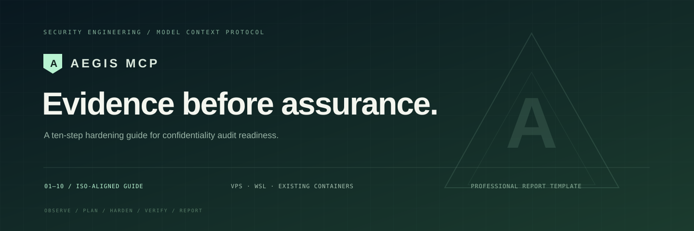
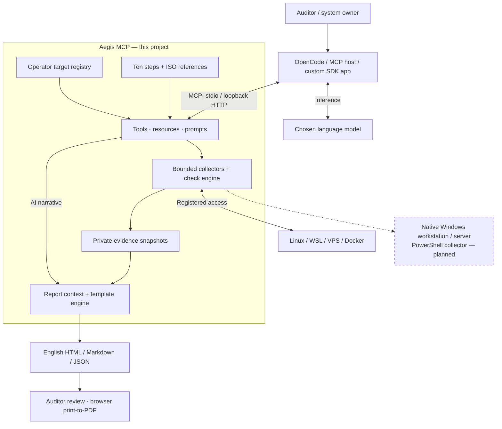
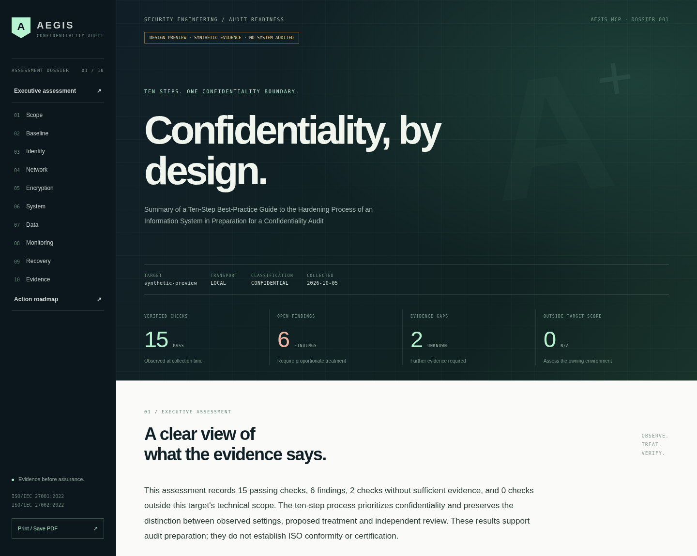

<p align="center"></p>

# Aegis MCP

**An AI-assisted, ten-step confidentiality hardening project for Linux and Windows architectures, with MCP integration and professional reporting.**

The auditor uses OpenCode, another MCP-compatible AI host, or a custom SDK application. The host connects the chosen model to Aegis; Aegis collects evidence from operator-registered systems, evaluates it against an embedded best-practice guide, and renders a professional English report. The model explains findings and priorities while the server supplies the evidence tables, ISO references and visual design.

> **Project subject:** Summary of a Ten-Step Best-Practice Guide to the Hardening Process of an Information System in Preparation for a Confidentiality Audit

The guide and every report preserve **exactly ten steps**. The operator provides an authorized existing architecture; this repository implements the MCP server and report workflow.

**Implementation status:** Linux, Linux inside WSL, Linux VPSs over SSH and existing Linux containers have implemented collectors. Native Windows uses a separate PowerShell collector in the extension design below; that collector and Windows-specific checks are **planned**. A WSL assessment records the Linux guest, while a native Windows assessment must record Windows settings.

[Architecture](#system-architecture) · [Audit workflow](#from-an-audit-request-to-a-report) · [Ten-step guide](#the-ten-step-method) · [ISO references](#how-iso-references-guide-the-assessment) · [Setup](#getting-started) · [Report preview](docs/assets/report-preview.html)

## Who uses it and why

| User | Use | Deliverable |
| --- | --- | --- |
| Auditor or student | Assess an authorized system using the ten-step method | Traceable findings, missing evidence and an English audit dossier |
| System administrator | Review a hardening plan and verify supported changes | Exact diffs, prerequisites and a before/after comparison |
| Professor or technical reviewer | Follow the method from system observations to conclusions | Consistent ten-step structure, ISO mappings and independent review items |

## System architecture



**The host coordinates; the model interprets; Aegis collects, evaluates and renders; the auditor reviews.** Model credentials and inference belong to the host. Aegis uses the MCP protocol to expose capabilities to that host, as described in the [official MCP architecture](https://modelcontextprotocol.io/docs/learn/architecture).

| Layer | Implementation | Responsibility |
| --- | --- | --- |
| MCP interface | `server.py`, official Python MCP SDK | Expose nine tools, four resources and two prompts over stdio or loopback HTTP |
| Method and references | `catalog.py`, `assets/prompts/` | Keep the exact subject, ten guide steps, ISO identifiers and AI workflow instructions |
| Audit orchestration | `engine.py`, `checks.py` | Collect observations, evaluate checks, preserve review gaps and manage plans/comparisons |
| Target access | `targets.py`, `agent.py` | Resolve registered IDs and run fixed, bounded Linux collection/remediation operations |
| Evidence custody | `workspace.py`, private `.runtime/` | Store SHA-256-addressed snapshots, HMAC-sealed plans and chained workflow events |
| Report generation | `reporting.py`, `assets/templates/` | Validate AI narrative and generate consistent offline reports from recorded evidence |

The operator configures addresses, access, container names and metadata paths locally. MCP calls use registered IDs such as `wsl` or `vps`; the model cannot supply an arbitrary destination or shell command through Aegis tools. An architecture with several registered nodes is assessed node by node, with a separate audit/report for each target. Dashed Windows elements show the planned extension. [Technical data flow and trust boundaries](docs/architecture.md).

## From an audit request to a report

| Phase | Interaction | Result |
| --- | --- | --- |
| Define the scope | Auditor registers owned/authorized targets; host connects Aegis to the selected model | Known target IDs and explicit access boundaries |
| Load the method | Model calls `get_hardening_guide` and `list_targets` | Exact subject, ten steps, ISO references and target capabilities |
| Gather evidence | `audit_target(target_id)` runs the bounded collector | Timestamped observations, check statuses, review items and an `audit_id` |
| Review treatment | If requested, `create_hardening_plan(target_id, audit_id)` | Supported actions, exact diffs, prerequisites and manual work |
| Verify changes | When authorized and enabled, apply the plan and compare the returned after audit with the before audit | Recorded changes and observed status transitions |
| Draft once | `get_report_context(audit_id)` supplies compact facts, the writing brief and narrative schema | Model writes a short summary, priorities and optional step notes |
| Render and review | `render_report(audit_id, narrative)` fills the packaged template | HTML, Markdown and JSON paths for auditor review; PDF via browser printing |

The read-only audit-to-report path works without applying a plan. For example, an auditor can ask OpenCode to assess `wsl`, receive an audit ID, review gaps and produce a report using the same snapshot. Reassessing is useful after a change or when evidence has become stale.

## The ten-step method

| Step | Best-practice domain | Confidentiality purpose | Suggested ISO/IEC 27001 Annex A controls |
| --- | --- | --- | --- |
| 01 | Scope, inventory and classify | Know which assets and data need protection | A.5.9, A.5.12, A.5.13 |
| 02 | Maintain a patched baseline | Reduce exposure from vulnerable software | A.8.8, A.8.9 |
| 03 | Constrain identities and access | Permit access only to approved identities | A.5.15, A.5.16, A.5.18, A.8.2, A.8.5 |
| 04 | Separate network trust zones | Restrict unintended paths to sensitive services | A.8.20–A.8.22 |
| 05 | Protect cryptography and keys | Protect confidential data in transit and storage | A.8.24, A.5.17 |
| 06 | Reduce system attack surface | Reduce information leaks and excess privilege | A.8.9, A.8.19, A.8.27 |
| 07 | Minimize data exposure | Reduce permissive files and data disclosure | A.8.3, A.8.11, A.8.12, A.5.34 |
| 08 | Observe and investigate access | Produce usable access and incident evidence | A.8.15–A.8.17 |
| 09 | Secure backups and prove recovery | Protect copies and demonstrate recovery | A.8.13, A.5.30 |
| 10 | Validate and build the audit dossier | Preserve evidence, review gaps and verify changes | A.5.35, A.5.36, A.8.32 |

Each step supplies a risk, best practice, expected audit evidence and suggested standards mapping. Technical checks use `pass`, `fail`, `unknown` or `not_applicable`; organizational and application controls retain independent human review items. Missing evidence and inherited host controls never become passes. Read the [complete embedded guide](docs/ten-step-guide.md).

## How ISO references guide the assessment

| Reference | Role in the project | Auditor's use |
| --- | --- | --- |
| [ISO/IEC 27001:2022](https://www.iso.org/standard/27001) | ISMS requirements and suggested clause/Annex A mappings | Establish scope, assess risks and validate control applicability |
| [ISO/IEC 27002:2022](https://www.iso.org/standard/75652.html) | Guidance for information-security controls | Consult implementation guidance and identify the evidence needed for each domain |
| ISO/IEC 27001:2022/Amd 1:2024, linked from the official 27001 page | Amendment concerning organizational context | Include the amendment when reviewing the actual ISMS context |

The model obtains the project's original guidance and official reference links through `get_hardening_guide`, `aegis://standards/mappings` and `get_report_context`. Clause and control identifiers orient the assessment; they are suggested mappings for the auditor to validate against the organization and its Statement of Applicability (the record of applicable controls and their justification).

For the normative text, the auditor follows the official ISO links or uses institutional access under its permitted terms. The MCP supplies original guidance, identifiers and links; the full standards remain separately managed references. ISO's publication terms also govern permitted AI use of its text. Technical snapshots support audit preparation and require organizational evidence and independent review before any conformity conclusion.

## Getting started

Requires Python 3.11+, [uv](https://docs.astral.sh/uv/) and a Linux execution environment. Run the server in WSL when using a Windows machine. SSH targets and existing containers need Python 3.9+ inside the target; missing tools are recorded as missing evidence.

```bash
uv sync --frozen
cp --no-clobber targets.example.yaml targets.yaml
# Edit targets.yaml: keep only targets you own and intend to assess.
uv run aegis doctor
uv run aegis-mcp
```

`aegis-mcp` waits for an AI client over stdio. It does not print a dashboard. Register the launch command in your MCP client using [the connection examples](docs/connecting-ai.md).

You can verify setup before connecting an AI:

```bash
uv run aegis guide
uv run aegis targets
uv run aegis audit wsl
# Save the returned audit_id and use it in the following commands.
uv run aegis plan wsl --audit <audit_id>
uv run aegis report --audit <audit_id>
```

The report command fills the existing template with deterministic summary prose. A connected AI can supply a richer narrative through `get_report_context` and `render_report`.

## Connect OpenCode or another AI host

| Integration | Connection | Model handling |
| --- | --- | --- |
| OpenCode | Merge [examples/opencode.json](examples/opencode.json); verify with `opencode mcp list` | Select/configure the model in OpenCode |
| Another MCP-compatible host | Use the matching [stdio, VS Code or HTTP example](docs/connecting-ai.md) | The host manages its model and tool-use policy |
| Custom SDK application | Use an MCP SDK client plus a model SDK or local inference runtime | Your application forwards tool requests/results and controls the agent loop |

For OpenCode, follow the [setup instructions](docs/connecting-ai.md#opencode). Look for `aegis connected`; tools appear with names such as `aegis_audit_target`. The configuration shape is an `mcp` mapping, documented in [OpenCode's official MCP guide](https://opencode.ai/docs/en/mcp-servers/).

For clients using the common `mcpServers` configuration shape:

```json
{
  "mcpServers": {
    "aegis": {
      "command": "uv",
      "args": ["--directory", "/absolute/path/to/audit_mcp", "run", "--frozen", "aegis-mcp"],
      "env": {
        "AEGIS_TARGETS": "/absolute/path/to/audit_mcp/targets.yaml",
        "AEGIS_WORKSPACE": "/absolute/path/to/audit_mcp/.runtime",
        "AEGIS_ALLOW_APPLY": "0"
      }
    }
  }
}
```

Use absolute paths and make `uv` available to the client process. Client configuration shapes differ; see [connection examples](docs/connecting-ai.md). Aegis works with **MCP-compatible AI hosts**. A model without an MCP host needs an adapter. Your chosen host handles model credentials and inference; Aegis does not call a paid model itself.

Suggested first request:

> Use Aegis to summarize the ten-step hardening best-practice guide, audit my registered `wsl` target for confidentiality readiness, and produce a professional English report using the embedded template. Keep missing evidence and human review items visible. Do not apply target changes.

## MCP interface

| Tool | Result |
| --- | --- |
| `get_hardening_guide` | Exact English subject, ten steps and ISO links |
| `list_targets` | Locally registered IDs and capabilities |
| `audit_target` | Read-only target observations and a SHA-256 audit ID |
| `create_hardening_plan` | Sealed plan, exact diffs, prerequisites and manual work |
| `apply_hardening_plan` | Supported changes, target backup and after evidence |
| `rollback_hardening_plan` | Restore managed settings and collect new evidence |
| `compare_audits` | Status transitions between snapshots |
| `get_report_context` | Compact ten-step evidence, writing brief and narrative schema |
| `render_report` | Offline HTML, Markdown and JSON files |

| Resource | Supplies |
| --- | --- |
| `aegis://guide/ten-steps` | Exact subject and ten-step best-practice guide |
| `aegis://standards/mappings` | Suggested clause/control identifiers and official reference links |
| `aegis://report/director` | Instructions for concise, evidence-based AI narrative |
| `aegis://report/template` | Packaged report structure |

Two reusable prompts orient the model: `confidentiality_audit(target_id)` guides assessment, and `professional_report(audit_id, before_audit_id?)` supplies report context. Hosts that primarily support tools can follow the same workflow through the nine tools above.

## Professional report, with little model effort

The design is built in: editorial cover, mint accents, clear typography, ten-step evidence sections, ISO control chips, status filters, search, a before/after comparison and a print-to-PDF layout. It requires no external fonts, analytics or network requests.

The AI receives compact facts and a strict narrative schema. It drafts the title, executive summary, priorities and optional step notes once. The server generates all tables and styling. Narrative cannot override collected counts or statuses. HTML is escaped and protected by a restrictive content-security policy.

| Artifact | Contents | Use |
| --- | --- | --- |
| `report.html` | Ten-step findings, review items, AI narrative, references and visual navigation | Present the assessment; print/save a PDF in a browser |
| `report.md` | The same assessment in readable Markdown | Review conclusions and share approved text |
| `evidence.json` | Compact assessed evidence, scope, ISO mappings and optional comparison | Inspect the data supporting the report |

`render_report` returns absolute paths under `.runtime/reports/` for the selected audit. The template handles formatting and tables so the model can focus on concise, evidence-based interpretation.

Reports and system evidence stay in `.runtime/`, which is ignored by Git. Evidence may include operational hostnames, usernames and configured paths: review a report before sharing it externally.



The [interactive report preview](docs/assets/report-preview.html) uses **synthetic evidence** to demonstrate the design. See the [report structure and narrative contract](docs/report-template.md).

## Target scope and supported hardening

| Target | Access adapter | Status | Assessment boundary |
| --- | --- | --- | --- |
| Existing local Linux / WSL | Local Python collector | Implemented | Linux guest evidence; WSL findings do not establish Windows-host security |
| Existing Linux VPS | Key-authenticated SSH with strict host-key checks | Implemented | Visible guest settings and operator-configured metadata paths |
| Existing Linux Docker container | `docker exec` into the registered container | Implemented | Container evidence; audit-only, with host controls requiring separate assessment |
| Native Windows workstation / server | Bounded PowerShell collector and Windows checks | Planned | Windows configuration evidence under the same ten-step method |

Linux is the implemented collection scope. Application IAM, cloud policies, hypervisors and organizational practices require separate evidence and human review. SSH/container targets need Python 3.9+; collection needs the permissions appropriate to each check. The collector is ephemeral and reads fixed system settings and configured file metadata.

The native Windows design retains the same MCP workflow and report structure, using Windows-specific evidence for updates, privileged accounts, firewall profiles, BitLocker status, service privileges, NTFS permissions, audit logging and backups. Its checks should use an operator-approved baseline, guided by [Microsoft's Windows security baselines](https://learn.microsoft.com/en-us/windows/security/operating-system-security/device-management/windows-security-configuration-framework/windows-security-baselines). See the [Windows extension design](docs/architecture.md#native-windows-extension-design); it requires implementation and operational validation before native Windows audits are available.

Audit collection is read-only on the target. Target changes require **both** `AEGIS_ALLOW_APPLY=1` in the server environment and `allow_apply: true` for the target. The operator still controls conversational authorization through the AI host.

The current automatic catalogue is deliberately explicit:

- Linux kernel information-disclosure and link-protection settings: `dmesg_restrict`, `kptr_restrict`, `protected_hardlinks`, `protected_symlinks`.
- A managed login-shell `umask 027` drop-in. Existing processes and service policies are unaffected.
- Key-only SSH and disabled direct root SSH login, after independent key access and configuration prerequisites are verified locally.

Patching, firewall changes, application IAM, volume encryption, MFA, logging custody, backup encryption and restore exercises are guided work requiring environment-specific review. Docker targets are audit-only; WSL kernel controls are inherited from its host. Aegis does not provision, restart or rebuild containers.

[Read the exact prerequisites and rollback behavior](docs/hardening.md) before enabling target writes.

## Development and verification

```bash
uv sync --frozen
uv run ruff check src tests scripts
uv run pytest -q
uv run python scripts/check_repository.py
uv run pip-audit --skip-editable
uv build
```

Tests cover the real MCP protocol using synthetic target evidence, target/option injection, evidence tampering, local permission gates, stale plans, rollback, inherited-control handling, report escaping and content-security hashes. Adapter and operational test boundaries are documented in [validation](docs/validation.md).

## Repository layout

```text
src/aegis_mcp/      MCP server, bounded collector, adapters, evidence and reporting
  assets/prompts/  Ten-step workflow and one-pass report director
  assets/templates/ Professional offline HTML/CSS/JS template
docs/              Setup, guide, architecture, hardening and template preview
examples/          MCP host configuration examples
tests/             Protocol, security and report regression tests
scripts/           Publication checks and synthetic template preview
targets.example.yaml Operator target configuration template
uv.lock            Locked dependencies
```

ISO mapping references: [ISO/IEC 27001:2022](https://www.iso.org/standard/27001), [ISO/IEC 27002:2022](https://www.iso.org/standard/75652.html). This repository contains original guidance and control identifiers, not copied ISO standard text. See [SECURITY.md](SECURITY.md) and [MIT license](LICENSE).
