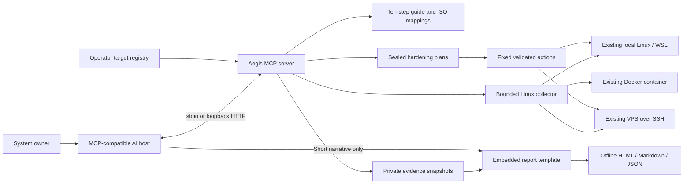

# Architecture

The model can name a registered ID but cannot supply a target address, arbitrary path to read, or command. Metadata paths are registered by the operator in `targets.yaml`. Aegis does not provision infrastructure or call a model provider.

The guide is the product's organizing structure. Checks emit separate pass/fail/unknown/not-applicable states. Every domain retains an independent review requirement. The connected AI adds narrative; the renderer owns evidence tables and status counts.

Snapshots use content hashes, plans use HMAC seals, and events use a local hash chain. These protect against accidental changes and tampering without the workspace key. They do not protect against the local operator or a compromised MCP process, both of which can alter the store. For audit-grade custody, export evidence to a trusted independently controlled repository.

The collector is ephemeral and uses only Python's standard library. SSH never disables host-key checking or accepts a password through MCP. Docker inspection does not claim host or image security. WSL evidence does not establish Windows-host hardening.
