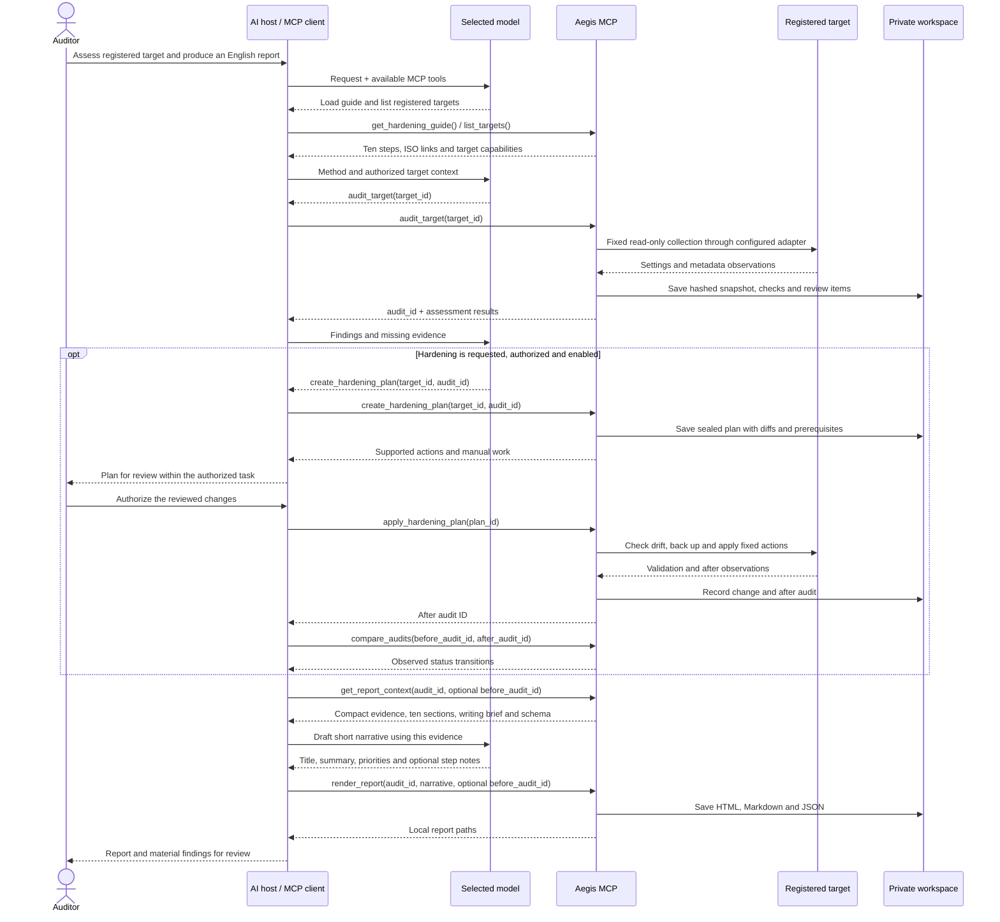

# Technical architecture

Aegis implements the MCP service between an auditor's AI host and operator-registered systems. The host runs the model interaction; Aegis owns the assessment method, target adapters, evidence processing and report rendering. The [README system diagram](../README.md#system-architecture) shows the complete project at a glance.

## Components and their responsibilities

| Component | Source | Responsibility |
| --- | --- | --- |
| Protocol interface | [server.py](../src/aegis_mcp/server.py) | Register nine tools, four resources and two prompts; expose stdio or loopback Streamable HTTP |
| Method catalogue | [catalog.py](../src/aegis_mcp/catalog.py) | Preserve the exact English subject, ten domains, original best practices and suggested ISO clause/control mappings |
| Workflow engine | [engine.py](../src/aegis_mcp/engine.py) | Coordinate collection, snapshots, plans, mutation gates, comparisons and report export |
| Check evaluation | [checks.py](../src/aegis_mcp/checks.py) | Produce separate technical check statuses and independent review requirements |
| Target registry and adapters | [targets.py](../src/aegis_mcp/targets.py) | Load operator configuration and resolve local, SSH or Docker access from registered IDs |
| Ephemeral collector | [agent.py](../src/aegis_mcp/agent.py) | Run bounded standard-library Linux collection and the fixed remediation/rollback catalogue |
| Private workspace | [workspace.py](../src/aegis_mcp/workspace.py) | Protect workspace paths, serialize writes, hash snapshots, seal plans and chain events |
| Report engine | [reporting.py](../src/aegis_mcp/reporting.py) | Build compact context, validate narrative and export escaped HTML, Markdown and evidence JSON |
| Embedded assets | [assets/](../src/aegis_mcp/assets/) | Supply workflow/report prompts and the offline Jinja, CSS and JavaScript template |

## From request to reviewed report



The host executes model-requested calls through its MCP client and returns results to the model. It manages model credentials, conversation, permissions and the agent loop. A custom integration therefore combines an MCP client SDK with a model SDK or local inference runtime. See the [SDK connection example](connecting-ai.md#custom-sdk-application) and the [official MCP architecture](https://modelcontextprotocol.io/docs/learn/architecture).

The read-only path goes directly from assessment to report context and rendering. The optional change path requires operator configuration and authorization for the task. Configuration gates do not establish conversational authorization by themselves.

## Target access and collection boundary

The operator stores target registration in the ignored `targets.yaml`: access transport, host/user or container, owner, classification and permitted metadata paths. A tool accepts a registered ID, never a model-supplied address, arbitrary file path or command.

| Adapter | Mechanism | Boundary |
| --- | --- | --- |
| Local | Current Python interpreter runs the packaged collector | Existing Linux/WSL guest; host-owned WSL controls remain inherited |
| SSH | Batch-mode key access, strict known-host verification and remote `python3` | Existing Linux VPS; optional `sudo -n` configured locally |
| Docker | `docker exec` into the registered existing container | Audit-only container observations; host/image/cloud evidence remains separate |

The implemented collector is ephemeral and uses Python's standard library. It reads fixed system settings and metadata from explicitly registered sensitive/backup paths. Remote/container Python must be 3.9+. Missing utilities or insufficient visibility produce missing evidence rather than an invented success.

Windows and Linux are distinct assessment boundaries: a Linux collector running in WSL records Linux guest evidence. Native Windows settings require a Windows collector and Windows-specific check evaluation.

An architecture with several nodes is represented by several registered target IDs. Each snapshot and report concerns one target. Application permissions, cloud network policies, Windows hosts, hypervisors, key custody and actual recovery exercises require additional evidence and auditor review.

## Native Windows extension design

This is a planned branch of the project architecture. Its PowerShell collector, platform registration and Windows-specific checks are not implemented in the current release. The design keeps the existing tool names, ten-step organization and report contract, and supplies a separate source of Windows observations.

```text
Registered Windows target
    -> bounded read-only PowerShell collector
    -> Windows-specific checks + independent review requirements
    -> common evidence snapshot and compact report context
    -> AI narrative + existing report renderer
```

| Guide step | Windows evidence to support |
| --- | --- |
| 01. Scope, inventory and classify | OS version/edition, host role, owner and registered data scope |
| 02. Maintain a patched baseline | Installed updates and update-policy indicators; patch freshness needs review |
| 03. Constrain identities and access | Local privileged-account membership and remote-management policy |
| 04. Separate network trust zones | Firewall-profile configuration and permitted management exposure |
| 05. Protect cryptography and keys | BitLocker protection status for in-scope volumes; separate key-custody review |
| 06. Reduce system attack surface | Service privileges and endpoint-protection/baseline indicators |
| 07. Minimize data exposure | ACL metadata for operator-registered sensitive paths |
| 08. Observe and investigate access | Audit-policy, event-log and time-synchronization settings |
| 09. Secure backups and prove recovery | Registered backup metadata; independent encryption and restore evidence |
| 10. Validate and build the audit dossier | Traceable Windows snapshots, review gaps and the same English report structure |

Implementation should use an operator-approved baseline informed by [Microsoft's Windows security baselines](https://learn.microsoft.com/en-us/windows/security/operating-system-security/device-management/windows-security-configuration-framework/windows-security-baselines). Read-only sources can include [Get-NetFirewallProfile](https://learn.microsoft.com/en-us/powershell/module/netsecurity/get-netfirewallprofile) and [Get-BitLockerVolume](https://learn.microsoft.com/en-us/powershell/module/bitlocker/get-bitlockervolume?view=windowsserver2025-ps). Privilege requirements, unavailable modules and policy ownership must be reflected as evidence gaps. Native Windows remediation requires its own reviewed actions, backups, validation and rollback design.

## Standards context and AI orientation

The reference path is explicit:

```text
Original ten-step guide + proposed clause/control mappings + official ISO links
    -> MCP guide / standards resource / report context
    -> model's evidence-based explanation
    -> auditor validates applicability and supporting evidence
```

`get_hardening_guide` exposes the subject, ten domains and ISO reference links. `aegis://standards/mappings` includes the catalogue's proposed identifiers and sources. `get_report_context` places the same method, review requirements and reference links next to the collected checks.

ISO/IEC 27001 supplies ISMS requirements; ISO/IEC 27002 supplies control guidance. Their [official publication pages](../README.md#how-iso-references-guide-the-assessment) orient the auditor to authoritative references and permitted access. Aegis distributes its own guidance and mappings. Full standard text and organizational evidence remain separately managed references; they are not a prerequisite for calling the built-in tools.

The packaged `confidentiality_audit` prompt directs the assessment workflow. The `professional_report` prompt and report director keep narrative focused on observed confidentiality risk, proportionate treatment and remaining verification. Host support for prompts/resources varies, so the tools also provide the required guide and report context.

## Separate evidence, commentary and human review

| Kind | Producer | Treatment in the report |
| --- | --- | --- |
| Observed evidence | Collector and check engine | Traceable settings, timestamps, check IDs and technical statuses |
| AI commentary | Model through the host | Schema-limited title, summary, context, priorities and step notes |
| Human review | Auditor/system owner | Applicability, organizational controls, evidence sufficiency and residual-risk decisions |

Narrative cannot replace recorded check results or status counts. A `pass` means one technical check passed at collection time; `unknown` means insufficient evidence; `not_applicable` can identify a control owned outside the target. Organizational review remains independent of those statuses.

Target observations, hostnames, filenames and descriptions are untrusted data. The AI instructions tell the model to interpret them as evidence. Report rendering escapes narrative and target values; only packaged CSS/JavaScript are trusted, with hashes in a restrictive content-security policy.

## Change authorization and evidence integrity

The engine requires `AEGIS_ALLOW_APPLY=1` and target `allow_apply: true` for mutation. It validates sealed plans, the target registration, prerequisites and configuration drift. Supported actions have backups, validation and after evidence; successful plans can be rolled back when their managed configuration has not drifted. See [hardening prerequisites](hardening.md).

Snapshots use content hashes, plans use HMAC seals, and events use a local hash chain. These detect changes to recorded artifacts, with plan authentication depending on the private workspace key. The local operator or a compromised MCP process can still alter the store and its keys. Evidence requiring independent custody should be exported to an independently controlled repository.

Runtime artifacts and target registrations stay private and ignored by Git. A local report remains sensitive even though its HTML works offline; review operational identifiers and commentary before sharing it.
